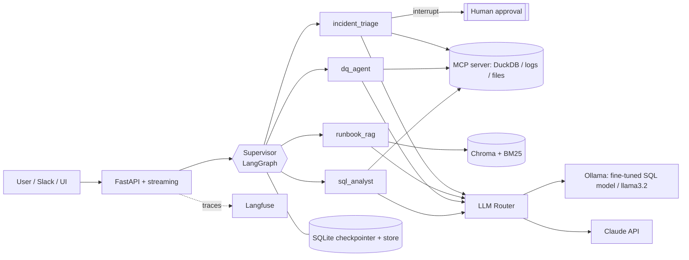

# Architecture

## Key decisions (ADRs to write in week 13)
1. Supervisor vs swarm topology · 2. MCP as the tool boundary (least privilege, read-only creds)
3. Local-first routing with confidence-based escalation to Claude · 4. HITL before any write/side effect
5. Eval suites as CI gates · 6. State schema & persistence

## Non-functional targets
p95 latency < 8s for single-agent requests · ≤ $0.02 average per request · ≥ 60% of calls served locally ·
zero write actions without approval · every run traced.
